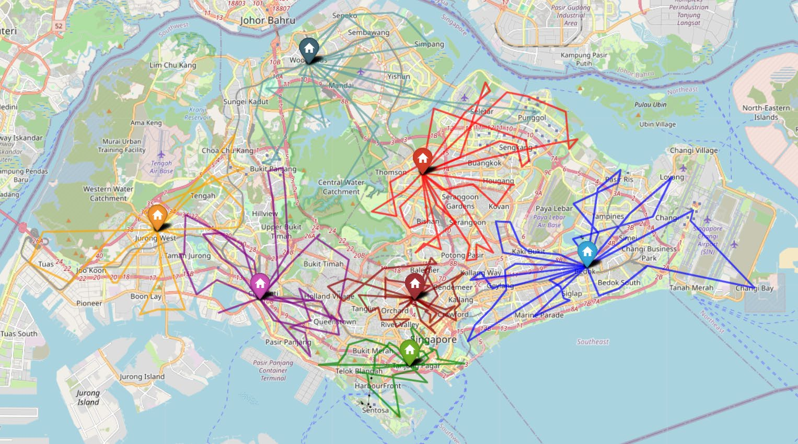
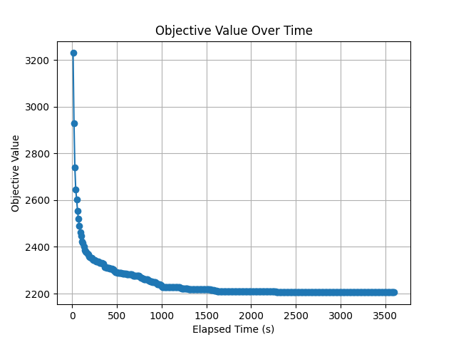
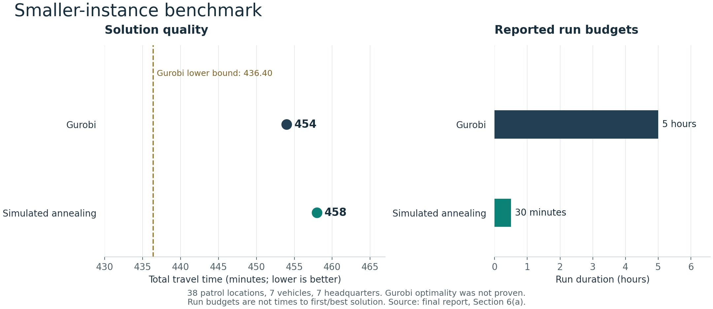

# Singapore Police Patrol Routing

**How can 56 patrol vehicles cover 304 Singapore subzones in one night while minimising travel time?** We model the problem as routing from seven headquarters within a ten-hour shift, then combine a greedy initial solution with simulated annealing and five local search operators.

The final saved full-instance run achieved **2,205 minutes of total travel across all vehicles** after a one-hour search. Its routes cover every patrol location exactly once and return to their assigned headquarters within the shift. A smaller-instance benchmark compares the heuristic with a Gurobi mixed-integer formulation.

A group project for SUTD's **40.018 Heuristics and Systems Theory (2025)**.

Patrol durations are simulated. This is an academic routing study; the routes are not operational police schedules.

## Report and results

- [Final project report](Final%20Project%20Report.pdf): formulation, experiments, visualisations, and discussion.
- [Saved experiment index](RESULTS.md): links to the HTML maps and plots, with their recorded feasibility status.
- [Interactive showcase](https://pengsiangtang.github.io/Heuristics-Project-Route-Optimization/): explore the final route map, convergence plot, and benchmark in your browser. The [page source](docs/index.html) is included in this repository.

### Final route map



*Figure 12 from the report: patrol tours grouped by headquarters. Lines connect visited locations rather than tracing roads; the objective uses driving travel times. Basemap © [OpenStreetMap contributors](https://www.openstreetmap.org/copyright).*

### Full-instance convergence



*The original objective trace from `tsp_SAgreedy_report_20250707_001515.html`: large early improvements give way to smaller gains, ending at 2,205 minutes. The optimisation was not rerun to create this figure.*

### Smaller-instance comparison



*Redrawn from Section 6(a) of the report: simulated annealing finished four travel minutes above Gurobi's final incumbent on the 38-location instance. Gurobi did not prove optimality. The chart compares reported run budgets, not times to first or best solution.*

The report describes a full-instance simulated annealing solution with total travel time **2,205 minutes** after a one-hour run. On the smaller instance, it reports objectives of **454 for Gurobi** after five hours and **458 for simulated annealing** in a thirty-minute run. These are historical reported results, not results reproduced by this repository cleanup. The Gurobi result was an incumbent with a remaining optimality gap, not a proven optimum.

The report says full-instance Gurobi found no feasible solution after ten hours. The current notebooks set Gurobi's time limit to 18,000 seconds (five hours); the archived report and the current settings represent different runs.

## Repository layout

```text
data/                          Shared CSV inputs
1 Data Cleaning/               Optional Google Maps data collection and preprocessing
2 Solving Actual Size Problem/ Full-instance Gurobi and metaheuristics notebooks
3 Solving a Smaller Instance/  Smaller-instance benchmarking notebooks and saved log
Final Project Report.pdf       Original submission
RESULTS.md                     Index of archived HTML runs
docs/                          GitHub Pages showcase, figures, and route audit
```

The three original CSV folders contained byte-identical copies. All notebooks now use the shared `data/` directory. Notebook names and historical outputs are retained.

## Setup

The original notebook metadata records Python 3.11.5 and 3.11.10. Python 3.11 is the suggested starting point; the original package versions were not recorded, so the dependency lists are not an exact environment lock.

From the repository root, in PowerShell:

```powershell
py -3.11 -m venv .venv
.\.venv\Scripts\python.exe -m pip install -r requirements.txt
.\.venv\Scripts\python.exe -m jupyter lab
```

In VS Code, select `.venv` as the notebook kernel. Open notebooks from within the project: their first code cell locates the repository and shared data from the current working directory.

### Gurobi notebooks

Install the optional solver dependency in the same environment:

```powershell
.\.venv\Scripts\python.exe -m pip install -r requirements-gurobi.txt
```

Configure a Gurobi licence that supports the model size before solving. Installing `gurobipy` alone includes a restricted, size-limited licence; it does not establish that these models can run under that licence. Eligible academic users can obtain an academic licence. See [Gurobi installation](https://support.gurobi.com/hc/en-us/articles/360044290292-How-do-I-install-Gurobi-for-Python) and [licensing](https://www.gurobi.com/product/pricing-and-licensing).

The metaheuristics notebooks do not require Gurobi. New solver runs write `my_gurobi_log.log` in their respective notebook folder; the final plotting cell reads that same log. The smaller-instance `gurobi_log.txt` remains an archived log of an earlier run.

## Execution order

1. **Use the included CSVs** to explore the optimisation without collecting data again. No Google Maps API key is needed for the solver or metaheuristics notebooks.
2. For a smaller benchmark, open either notebook in `3 Solving a Smaller Instance/` and run its cells in order. Both notebooks derive the smaller instance from the shared full dataset by slicing every eighth location.
3. For the full problem, open either notebook in `2 Solving Actual Size Problem/` and run its cells in order. The Gurobi and metaheuristics notebooks are independent alternatives.
4. Within the full-instance metaheuristics notebook, the simulated annealing, random-initial local search, and K-means sections are separate experiments. Inspect the run cells before using Run All: the SA and local-search calls each request 1,800 seconds, and Gurobi requests 18,000 seconds.

Randomised methods can produce different routes and objective values on reruns. HTML reports are written to the kernel's current working directory. Keep new runs separate when comparing with the archived experiments.

### Optional data collection

Only rerun `1 Data Cleaning/data cleaning.ipynb` if you intend to collect travel times again. Its API loops make many requests, and its CSV exports overwrite files in `data/`. The notebook is the original preprocessing workflow, not an automated pipeline that regenerates every final CSV: the supplied `T.csv` and `patrol timings.csv` remain the optimisation inputs.

Set your own key in PowerShell **before starting Jupyter from that terminal**:

```powershell
$env:GOOGLE_MAPS_API_KEY = "YOUR_OWN_KEY"
.\.venv\Scripts\python.exe -m jupyter lab
```

The notebook reads `os.environ["GOOGLE_MAPS_API_KEY"]`; a missing variable raises `KeyError`. For VS Code, ensure the notebook kernel inherits that variable before running data collection. Do not save the key in notebook cells or outputs. Local `.env` files and Gurobi licence files are ignored by Git.

## Interpreting feasibility

- Historical HTML files retain their original `Feasible: True/False` values. The results index transcribes those values; it does not revalidate the routes.
- The showcased one-hour run was separately checked against the shared CSVs: 304 unique patrol visits, 56 routes, assigned start/end depots, no intermediate depot visits, all route durations within 600 minutes, and total travel time of 2,205 minutes. The [verification summary](docs/assets/run-summary.json) includes the routes and source hashes. Its latest return is **599 minutes**; the report's prose lists 559. The showcase uses the value in the saved HTML and recomputed routes; the original files are unchanged.
- In the current metaheuristics code, `feasible_solution` checks only that each route's duration is at most 600 minutes. Full feasibility also requires checking coverage, duplicate visits, and depot assignment. New HTML exports explicitly label the check as a **route-duration check**.
- An infeasible candidate's objective is not a valid feasible-solution benchmark. A missing status is **unknown**, not feasible.
- A Gurobi time-limit exit does not imply a solution exists. The notebooks now check `SolCount > 0` before accessing objective values and routes, and distinguish a feasible incumbent from a proven optimum.
- Full and smaller instances must be compared separately. Historical filenames alone do not reliably identify instance size.

## Team and contributions

As recorded on the report's cover page:

| Team member | Contributions |
| --- | --- |
| Carrie Tan | Mathematical formulation and Gurobi code; running Gurobi and metaheuristics on a smaller instance for benchmarking; report generation. |
| Chong Jun Hui | Mathematical formulation and data preprocessing; simulated annealing algorithm and tuning; greedy heuristic initial solution; report generation. |
| Tang Peng Siang | Mathematical formulation and Gurobi code; local search operators and local search; map visualisation; K-means initial solution; report generation. |

See the report for the original references and data sources.

## Publishing the interactive page

The static page is ready in `docs/`; it does not require Python, a Google Maps API key, or a build step to serve. Open `docs/index.html` in a browser for a local preview. Its map uses external Leaflet libraries and OpenStreetMap tiles, so an internet connection is required for the interactive basemap; the static figures remain available locally.

After pushing this repository to GitHub:

1. Open **Settings → Pages**.
2. Set **Source** to **Deploy from a branch**.
3. Choose **`master`** and the **`/docs`** folder, then save.
4. Use the URL shown by GitHub Pages as the live showcase link in this README.

This repository publishes from `master` → `/docs` at [the live showcase URL](https://pengsiangtang.github.io/Heuristics-Project-Route-Optimization/). Future pushes to that source update the page. See [GitHub's publishing-source instructions](https://docs.github.com/en/pages/getting-started-with-github-pages/configuring-a-publishing-source-for-your-github-pages-site).
